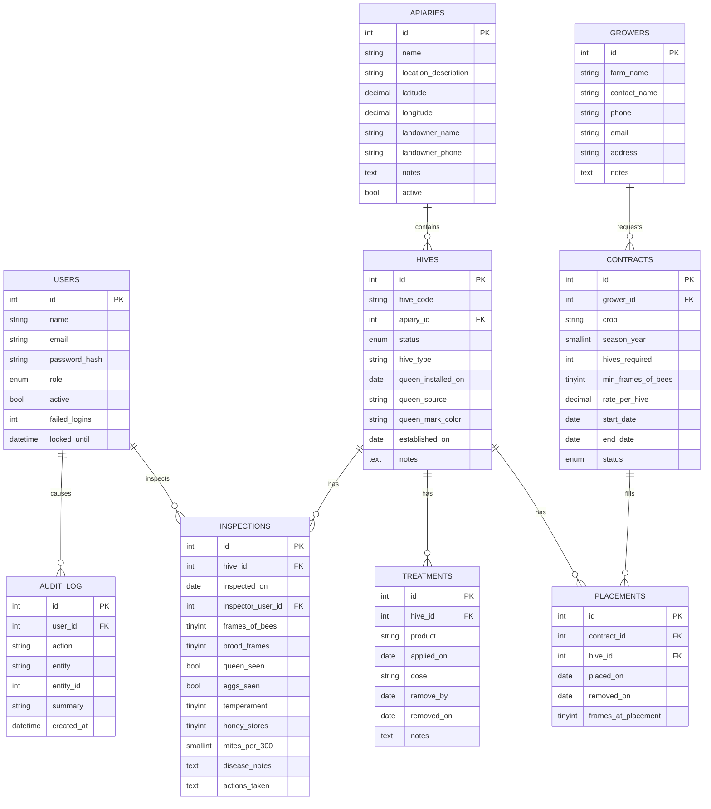

# PLAN.md — Pollination & Apiary Manager

## 1. Data model

All tables: InnoDB, utf8mb4/utf8mb4_0900_ai_ci, `created_at` / `updated_at` on every table,
foreign keys on every reference, an index on every foreign key and every column that is
searched, filtered, or sorted on.

### ER diagram

### Tables

1. **users** — `id, name, email (unique), password_hash, role ENUM('admin','manager','field_tech'), active, failed_logins, locked_until, created_at, updated_at`
2. **apiaries** — `id, name, location_description, latitude, longitude, landowner_name, landowner_phone, notes, active, created_at, updated_at`
3. **hives** — `id, hive_code (unique), apiary_id FK->apiaries, status ENUM('active','queenless','dead','sold','combined'), hive_type, queen_installed_on, queen_source, queen_mark_color, established_on, notes, created_at, updated_at`. Index on `apiary_id`, `status`.
4. **inspections** — `id, hive_id FK->hives, inspected_on, inspector_user_id FK->users, frames_of_bees, brood_frames, queen_seen, eggs_seen, temperament (1-5), honey_stores (1-5), mites_per_300 NULL, disease_notes, actions_taken, created_at, updated_at`. Index on `hive_id`, `inspected_on`, `inspector_user_id`.
5. **treatments** — `id, hive_id FK->hives, product, applied_on, dose, remove_by, removed_on, notes, created_at, updated_at`. Index on `hive_id`, `applied_on`, `remove_by`.
6. **growers** — `id, farm_name, contact_name, phone, email, address, notes, created_at, updated_at`.
7. **contracts** — `id, grower_id FK->growers, crop, season_year, hives_required, min_frames_of_bees, rate_per_hive, start_date, end_date, status ENUM('draft','signed','active','completed','invoiced'), created_at, updated_at`. Index on `grower_id`, `status`, `start_date`.
8. **placements** — `id, contract_id FK->contracts, hive_id FK->hives, placed_on, removed_on, frames_at_placement, created_at, updated_at`. Index on `contract_id`, `hive_id`, `placed_on`.
9. **audit_log** — `id, user_id FK->users (NULL on delete), action, entity, entity_id, summary, created_at`. Index on `user_id`, `entity`+`entity_id`, `created_at`.

### Business rules (enforced server-side, each with a test)

- No two placements for the same hive may have overlapping date ranges (open-ended `removed_on` counts as "still in").
- A placement is refused if the hive's latest inspection before `placed_on` shows fewer `frames_of_bees` than the contract's `min_frames_of_bees`.
- Hives with status `dead`, `sold`, or `combined` cannot receive new inspections, treatments, or placements.
- `removed_on >= placed_on`; `remove_by >= applied_on`.
- Field techs never receive `rate_per_hive` or any money total in HTML, CSV, or JSON responses.
- Every create/update/delete writes one `audit_log` row.

Mite load = `mites_per_300 / 3` (mites per 100 bees). "Over threshold" = latest wash's mite load
> `MITE_THRESHOLD` (env setting, default 3, read in `config/app.php`).

## 2. Routes

| Method | Path | Controller | Roles |
|---|---|---|---|
| GET/POST | /login | AuthController::login | guest |
| POST | /logout | AuthController::logout | any |
| GET | / , /dashboard | DashboardController::index | any |
| GET | /apiaries | ApiaryController::index | any |
| GET | /apiaries/create | ApiaryController::create | admin,manager |
| POST | /apiaries | ApiaryController::store | admin,manager |
| GET | /apiaries/{id}/edit | ApiaryController::edit | admin,manager |
| POST | /apiaries/{id} | ApiaryController::update | admin,manager |
| POST | /apiaries/{id}/delete | ApiaryController::destroy | admin,manager |
| GET | /hives | HiveController::index | any |
| GET | /hives/create | HiveController::create | admin,manager |
| POST | /hives | HiveController::store | admin,manager |
| GET | /hives/{id} | HiveController::show | any |
| GET | /hives/{id}/edit | HiveController::edit | admin,manager |
| POST | /hives/{id} | HiveController::update | admin,manager |
| POST | /hives/{id}/delete | HiveController::destroy | admin,manager |
| GET | /inspections | InspectionController::index | any |
| GET | /inspections/create | InspectionController::create | any (not field_tech-restricted; field techs log these) |
| POST | /inspections | InspectionController::store | any |
| GET | /inspections/{id}/edit | InspectionController::edit | admin,manager |
| POST | /inspections/{id} | InspectionController::update | admin,manager |
| POST | /inspections/{id}/delete | InspectionController::destroy | admin,manager |
| GET | /treatments | TreatmentController::index | any |
| GET | /treatments/create | TreatmentController::create | admin,manager,field_tech |
| POST | /treatments | TreatmentController::store | admin,manager,field_tech |
| GET | /treatments/{id}/edit | TreatmentController::edit | admin,manager |
| POST | /treatments/{id} | TreatmentController::update | admin,manager |
| POST | /treatments/{id}/delete | TreatmentController::destroy | admin,manager |
| GET | /growers | GrowerController::index | admin,manager |
| GET | /growers/create | GrowerController::create | admin,manager |
| POST | /growers | GrowerController::store | admin,manager |
| GET | /growers/{id}/edit | GrowerController::edit | admin,manager |
| POST | /growers/{id} | GrowerController::update | admin,manager |
| POST | /growers/{id}/delete | GrowerController::destroy | admin,manager |
| GET | /contracts | ContractController::index | admin,manager (field_tech: view, no prices) |
| GET | /contracts/create | ContractController::create | admin,manager |
| POST | /contracts | ContractController::store | admin,manager |
| GET | /contracts/{id} | ContractController::show | admin,manager,field_tech |
| GET | /contracts/{id}/edit | ContractController::edit | admin,manager |
| POST | /contracts/{id} | ContractController::update | admin,manager |
| POST | /contracts/{id}/delete | ContractController::destroy | admin,manager |
| GET | /contracts/{id}/planner | PlannerController::show | admin,manager |
| POST | /contracts/{id}/planner/assign | PlannerController::assign | admin,manager |
| POST | /placements/{id}/remove | PlacementController::remove | admin,manager |
| GET | /contracts/{id}/print | ContractController::print | admin,manager |
| GET | /export/{entity}.csv | ExportController::csv | any (field_tech export excludes money cols) |
| GET | /admin/users | AdminUserController::index | admin |
| GET | /admin/users/create | AdminUserController::create | admin |
| POST | /admin/users | AdminUserController::store | admin |
| GET | /admin/users/{id}/edit | AdminUserController::edit | admin |
| POST | /admin/users/{id} | AdminUserController::update | admin |
| POST | /admin/users/{id}/delete | AdminUserController::destroy | admin |
| GET | /admin/audit-log | AdminAuditController::index | admin |
| GET | /apiaries/search, /hives/search, ... | *Controller::search | matches index roles | returns JSON for the debounced live search |

Every route checks the signed-in user's role server-side in the router (not just hidden UI),
via a `roles: [...]` entry per route.

## 3. Pages (templates)

- `auth/login.php`
- `dashboard/index.php` (tiles, 3 charts, "Needs attention" panel)
- `apiaries/index.php`, `apiaries/form.php`
- `hives/index.php`, `hives/form.php`, `hives/show.php` (detail page)
- `inspections/index.php`, `inspections/form.php` (mobile-first stepper form)
- `treatments/index.php`, `treatments/form.php`
- `growers/index.php`, `growers/form.php`
- `contracts/index.php`, `contracts/form.php`, `contracts/show.php`, `contracts/planner.php`, `contracts/print.php`
- `admin/users_index.php`, `admin/users_form.php`, `admin/audit_index.php`
- `errors/403.php`, `errors/404.php`, `errors/500.php`
- `partials/pagination.php`, `partials/flash.php`, `partials/confirm_modal.php`

## 4. Milestone checklist

- [x] 1. Plan — this file + DECISIONS.md started.
- [x] 2. Skeleton — PHP built-in server fallback (no Docker on this machine, see DECISIONS.md), front controller, router, config, .env, layout, theme, placeholder logo, sign-in/out.
- [x] 3. Database — migrations, migrate script, seed script, planted stories verified by SQL.
- [x] 4. Core records — apiaries/hives/inspections/treatments CRUD + search + audit log + tests.
- [x] 5. Contracts — growers/contracts/placements/planner + overlap/min-frames/all-or-nothing tests.
- [x] 6. Dashboard & reports — tiles, charts, needs-attention, CSV export, print view.
- [x] 7. Roles/admin/polish — user admin, audit log page, role checks, error pages, empty states, 375px layout.
- [x] 8. Final pass — README.md, DEMO.md, clean-start test.
